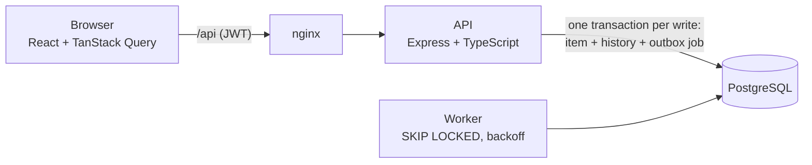

# Operations Under Pressure (newtonite-ops-23131010564)

[](https://github.com/Aryanonghub/newtonite-ops-23131010564/actions/workflows/ci.yml)

Teams (Payments, Support, Compliance, Platform) create, claim, approve and resolve work items, and the system
**stays correct when many people act on the same item at once**. Every rule is enforced on the server, most of
them by Postgres itself.

**Live demo: https://newtonite-ops-opal.vercel.app**. Pick a demo person on the sign-in page.

## Run it

```bash
git clone https://github.com/Aryanonghub/newtonite-ops-23131010564.git && cd newtonite-ops-23131010564
docker compose up --build        # needs Docker; free ports 8088, 3000, 5432
```

Open **http://localhost:8088**. Migrations and a seed (4 teams, 11 users, 20,000 items) run on first boot.
Start over with `docker compose down -v && docker compose up --build`.

**Logins** (password `password123`; one-click on the sign-in page):
`admin@` Admin of all teams · `priya@` Payments Lead · `mohan@` Payments Member · `sara@` Member of Payments + Support ·
`vik@` Viewer (read-only) · `lena@` Support Lead (can't see Payments). All `@ops.test`.

## The hard parts, and how to check them

Use separate browsers for two people (e.g. Chrome and Safari; incognito windows share one login).

| Situation | How it's handled | Try it | Test |
|---|---|---|---|
| **Two people claim one item** | `UPDATE … WHERE id = $1 AND assignee_id IS NULL`. 0 rows → **409** *"Mohan has already claimed this item."* | Mohan and Sara open the same item and both click **Claim**, or run `./scripts/race-claim.sh` → one `200`, one `409` | `claim.test.ts` |
| **Acting on a stale page** | Every write sends the `version` it saw: `WHERE version = $2`. A mismatch → **409** with the latest item and *who changed what* | Mohan and Priya both **Edit** one item; Priya saves first, then Mohan → refused | `optimistic-locking.test.ts` |
| **Double click / retry** | `Idempotency-Key` stored with the response **in the same transaction**; a repeat replays the response | Send one create twice with the same key → same id, `Idempotent-Replayed: true` | `idempotency.test.ts` |
| **Skipping workflow steps** | Allowed-moves map on the server (**422**). Only a Lead/Admin **of that team** approves (**403**), never the person who submitted it (four-eyes) | Priya submits her own item → no Approve button; `./scripts/race-approve.sh` → one `200`, one `409` | `workflow.test.ts` |
| **Access by team and role** | One function, `can()`, behind every endpoint. Outside the team → **404**; role too low → **403**; only the assignee or a Lead moves an assigned item | Lena opens a Payments item → *Not found*; Vik sees no buttons; Mohan can't submit Sara's item | `authorization.test.ts` |
| **History matches the item** | Change + history row + outbox job in **one transaction**; a DB trigger makes history append-only | Every change appears in the item's Activity | `activity.test.ts` |
| **Background work** | Transactional outbox; worker uses `SKIP LOCKED`, retries with backoff, gives up after 5; idempotent handler | Mohan claims Ada's item → Ada's bell shows it | `outbox.test.ts` |
| **UI ahead of the server** | Optimistic update, **rolled back** on 409/403 with the server's reason; success shown only once confirmed. Live updates refresh an open item within ~2 s | Lose a claim race → the page rolls back | Playwright `web/e2e/` |

The "same key twice" check from the terminal:

```bash
API=https://newtonite-ops-opal.vercel.app/api
T=$(curl -s -X POST $API/auth/login -H 'Content-Type: application/json' -d '{"email":"mohan@ops.test","password":"password123"}' | sed 's/.*"token":"\([^"]*\)".*/\1/')
K=demo-$(date +%s)                                   # one key, sent twice
for i in 1 2; do curl -s -D - -X POST $API/items -H "Authorization: Bearer $T" -H 'Content-Type: application/json' \
  -H "Idempotency-Key: $K" -d '{"title":"Double click","type":"task","priority":"low","team_id":1}' | grep -iE '^HTTP|replayed|"id"'; done
```

## Tests

```bash
docker compose up -d db && (cd server && npm ci && npm test)    # 79 tests against a real Postgres (~15 s)
(cd web && npm ci && npx playwright install chromium && npm run test:e2e)   # 4 browser tests; needs the app running
```

Server tests use a separate `*_test` database and never touch the demo data. CI runs them on every push.
**Proof they catch bugs:** delete `AND assignee_id IS NULL` from the claim in `server/src/routes/items.ts`, and
`npx vitest run tests/claim.test.ts` fails with `expected [200, 200] to deeply equal [200, 409]`.

## Architecture



Every write, in one transaction: idempotency key → load item → `can()` → workflow rule → conditional `UPDATE`
→ history row → outbox job → `COMMIT`. Any failure rolls back all of it.

| Where | What |
|---|---|
| `server/src/permissions.ts` | `can()`: every permission rule in one place |
| `server/src/workflow.ts` | allowed moves, approval rules |
| `server/src/routes/items.ts` | list (filters, search, cursor pagination), claim, transition, edit, comments, live stream |
| `server/src/idempotency.ts`, `worker.ts` | idempotent writes; outbox worker |
| `server/migrations/` | plain SQL: schema, indexes, CHECK invariants, append-only trigger |
| `web/src/pages/ItemPage.tsx` | optimistic updates and rollback |

**API:** `POST /auth/login` · `GET /items` (filters, `q`, `cursor`) · `POST /items` · `GET|PATCH /items/:id` ·
`POST /items/:id/claim` · `POST /items/:id/transition` · `POST /items/:id/comments` · `GET /items/:id/activity` ·
`GET /items/:id/live` · `GET /items/stats` · `GET /dashboard` · `GET /notifications`

## More

- **Why it's built this way** (choices, rejected options, costs, measured query plans):
  [ENGINEERING_DECISIONS.md](ENGINEERING_DECISIONS.md)
- **Known limitations and next steps:** [ENGINEERING_DECISIONS.md → Known limitations](ENGINEERING_DECISIONS.md#known-limitations)
- **Live deployment:** Vercel (the same Express app as one function) + Neon Postgres; no worker process, so the
  outbox is processed after each write. See decision 8.
