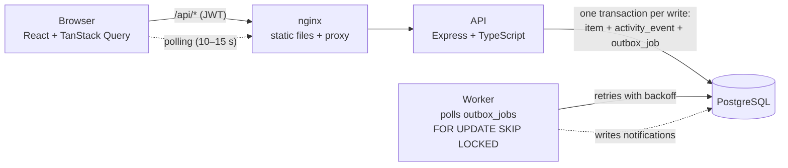

# Operations Under Pressure (newtonite-ops-23131010564)

An internal web app where teams such as Payments, Support and Compliance create, claim, track and resolve
work items. Items move through a server-enforced workflow (Open → In Progress → Awaiting Approval →
Resolved → Closed), and only a Lead of the item's team can approve. Every change is written to an
append-only activity history in the same database transaction as the change itself.

The focus is correct behaviour under pressure. Two people claiming the same item, stale edits, retried
requests and cross-team access are all handled on the server and covered by tests against a real Postgres.

## Prerequisites

- Docker Desktop (with Docker Compose v2)
- Node.js 22+ and npm, **only** for running the tests or the frontend dev server outside Docker
- Free ports: `8088` (web), `3000` (API), `5432` (Postgres)

## Run it

```bash
git clone https://github.com/Aryanonghub/newtonite-ops-23131010564.git
cd newtonite-ops-23131010564
docker compose up --build
```

Open **http://localhost:8088**. The first start takes a minute or two to build. On boot the API runs migrations and
seeds 4 teams, 11 users and 20,000 work items (with matching history). Seeding is skipped if data already exists.

| Service  | URL / port                 | What it is                                     |
|----------|----------------------------|------------------------------------------------|
| `web`    | http://localhost:8088      | React app (nginx), forwards `/api/*` to the API |
| `api`    | http://localhost:3000      | Express + TypeScript REST API                   |
| `worker` | (no port)                  | Outbox worker that delivers notifications       |
| `db`     | localhost:5432             | PostgreSQL 17 (user/password/db: `ops`)         |

Reset everything (wipes the database and re-seeds): `docker compose down -v && docker compose up --build`

Optional: copy `.env.example` to `.env` and set `JWT_SECRET`. Without it, a dev-only default is used.

## Demo logins

All passwords are **`password123`**. The login page has one-click buttons for these.

| Email             | Role(s)                                  | Good for trying                                  |
|-------------------|------------------------------------------|--------------------------------------------------|
| `admin@ops.test`  | Admin in all 4 teams                     | Sees everything, can approve anywhere            |
| `priya@ops.test`  | Lead, Payments                           | Approving items ("Awaiting my approval")         |
| `mohan@ops.test`  | Member, Payments                         | Create, claim, submit; **cannot** approve        |
| `sara@ops.test`   | Member, Payments **and** Support         | Multi-team user                                  |
| `vik@ops.test`    | Viewer, Payments and Compliance          | Read-only: no action buttons, API returns 403    |
| `lena@ops.test`   | Lead, Support                            | Cannot see Payments items at all (404)           |
| `tom@`, `carl@`, `cara@`, `omar@`, `pia@ops.test` | Support member, Compliance lead/member, Platform lead/member | |

## Run the tests

The tests run against a separate `ops_test` database in the same Postgres container (created on first start).

```bash
docker compose up -d db        # Postgres must be running
cd server
npm ci
npm test                       # 45 tests, about 10 seconds
```

The tests never touch the demo data. They refuse to run against any database whose name doesn't end in `_test`.

| Test file | Proves |
|---|---|
| `claim.test.ts` | 2 and 10 parallel claims → exactly one 200, the rest 409; DB and history agree |
| `optimistic-locking.test.ts` | PATCH/transition with an old `version` → 409 with the latest item; data and history unchanged |
| `idempotency.test.ts` | Same `Idempotency-Key` twice → one item, byte-identical response; different body → 422; 5 parallel same-key requests → one item |
| `workflow.test.ts` | Open → Closed rejected (422); Member approval rejected (403); Lead/Admin approval allowed; a second approver gets 409 (not a workflow error); full path recorded in order |
| `authorization.test.ts` | User from another team → 404 on every read and write; lists/dashboard scoped to own teams; Viewer read-only |
| `outbox.test.ts` | Job written in the same transaction; job processed twice → one notification; failing job retries with backoff then `failed`; two workers never run the same job |
| `list.test.ts` | Cursor pagination never skips or repeats rows (even with identical timestamps); filters; `%` in search is literal |
| `activity.test.ts` | History is append-only (DB rejects UPDATE/DELETE); a rejected write leaves no history |

**Proving the tests are real:** remove `AND assignee_id IS NULL` from the claim `UPDATE` in
`server/src/routes/items.ts` and run `npx vitest run tests/claim.test.ts`. All 3 claim tests fail
(`expected [200, 200] to deeply equal [200, 409]`). Restore it with `git checkout -- src/routes/items.ts`.

**See the race yourself** (with the app running):
- `./scripts/race-claim.sh`: two users claim the same item at the same instant → one `200`, one `409`.
- `./scripts/race-approve.sh`: a Lead and an Admin approve the same item, at the same instant and then
  2 seconds apart from an out-of-date page → one `200`, one `409` each time.

## Architecture



Every write follows the same order inside **one** database transaction:
claim idempotency key → load item → check permission → check workflow rule → conditional `UPDATE`
(version / assignee check) → insert activity event → insert outbox job → save idempotent response → `COMMIT`.
If any step fails, everything rolls back, so the history can never disagree with the item.

### Code map

```
server/
  migrations/            001 schema + indexes, 002 invariants, 003 notifications (plain SQL)
  src/permissions.ts     can(user, action, item): the single permission check
  src/workflow.ts        allowed-transitions map + Lead-only approval
  src/routes/items.ts    list, detail, create, PATCH, claim, transition, comments, activity
  src/idempotency.ts     Idempotency-Key handling
  src/worker.ts          outbox worker
  tests/                 integration tests (Vitest + Supertest, real Postgres)
web/src/
  pages/ItemPage.tsx     optimistic updates, rollback, "This item changed, reload"
  pages/ItemsPage.tsx    filters, search, cursor pagination ("Load more"), create dialog
```

### API

| Method & path | Notes |
|---|---|
| `POST /auth/login` | `{ email, password }` → `{ token }` |
| `GET /me` | current user and role per team |
| `GET /items?status=&priority=&type=&team=&assignee=me\|none\|<id>&q=&cursor=&limit=` | only your teams; newest first; `{ items, nextCursor }` |
| `POST /items` | **requires `Idempotency-Key` header** |
| `GET /items/:id` | 404 if not in your team |
| `PATCH /items/:id` | `{ version, title?, description?, priority?, due_date? }`; 409 on stale version |
| `POST /items/:id/claim` | Open → In Progress and assign to me; 409 if already claimed |
| `POST /items/:id/transition` | `{ to, version }` |
| `GET /items/:id/activity`, `POST /items/:id/comments` | history and comments |
| `GET /dashboard` | assigned to me / unassigned urgent / awaiting my approval |
| `GET /notifications` | written by the worker |

## Known limitations

See [ENGINEERING_DECISIONS.md](ENGINEERING_DECISIONS.md#known-limitations) for the full list. In short:

- Idempotency keys never expire (needs a cleanup job), and only `POST /items` uses them.
- No reassign/unassign: an item gets an assignee only by being claimed.
- Updates arrive by polling (10–15 s), not websockets. Notifications are in-app only, with no read/unread state.
- JWT is stored in `localStorage` with an 8-hour expiry: no refresh tokens, revocation or login rate limiting.
- Search is a case-insensitive match on the title only, with no ranking. The activity endpoint is not paginated.
- The optimistic-UI rollback was checked by hand in a browser; there are no automated frontend tests.

## References

Transaction pattern inspired by jajego/interlock; testing approach inspired by edwardmagongo/LedgerAPI;
product shape inspired by TicketForge.
No code was copied from these projects.
