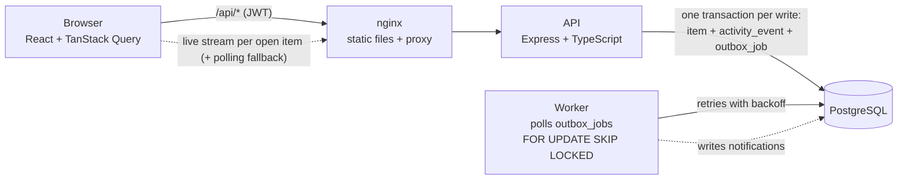

# Operations Under Pressure (newtonite-ops-23131010564)

[](https://github.com/Aryanonghub/newtonite-ops-23131010564/actions/workflows/ci.yml)

**Live demo: https://newtonite-ops-opal.vercel.app** (pick a demo person on the sign-in page; all passwords are `password123`).
The demo data is shared, so other visitors may be changing items at the same time, which is a good way to see the conflict handling.

An internal web app where teams such as Payments, Support and Compliance create, claim, track and resolve
work items. Items move through a server-enforced workflow (Open → In Progress → Awaiting Approval →
Resolved → Closed), and only a Lead of the item's team can approve. Every change is written to an
append-only activity history in the same database transaction as the change itself.

The focus is correct behaviour under pressure. Two people claiming the same item, stale edits, retried
requests and cross-team access are all handled on the server and covered by tests against a real Postgres.

## What happens under pressure

| Situation | What the system does | Proven by |
|---|---|---|
| Two people act on the same item at once | Claim is one conditional `UPDATE ... WHERE assignee_id IS NULL`. One wins; the other gets 409 *"Alice has already claimed this item."* | `claim.test.ts` (2 and 10 parallel claims), `scripts/race-claim.sh` |
| Someone acts from an out-of-date page | Every edit and move sends the `version` it saw. A mismatch is a 409 with the latest item and who changed what (*"Priya approved it since you loaded this item."*) | `optimistic-locking.test.ts`, `scripts/race-approve.sh` |
| A request is sent twice | `POST /items` requires an `Idempotency-Key`. A retry replays the stored response; the same key with a different body gets 422 | `idempotency.test.ts` |
| Someone tries to skip a workflow step | Allowed moves are a table on the server (422 otherwise). Only a Lead/Admin of the item's team can approve (403), and never the person who submitted it (four-eyes) | `workflow.test.ts` |
| Background work fails or runs twice | Notifications go through a transactional outbox. The worker retries with backoff, gives up as `failed`, and never delivers twice | `outbox.test.ts` |
| Someone outside the team probes an item | 404 on every read and write; lists and dashboard only show your teams; Viewers are read-only | `authorization.test.ts` |
| The UI shows a change before the server agrees | Optimistic update, rolled back on 409/403 with the server's reason; the success popup appears only after the server confirms | `web/e2e/optimistic-ui.spec.ts` (Playwright) |
| History must match what happened | Item change, history event and outbox job commit in one transaction; the database rejects UPDATE/DELETE on history | `activity.test.ts` |

The reasoning and trade-offs behind each of these are in [ENGINEERING_DECISIONS.md](ENGINEERING_DECISIONS.md).

## Prerequisites

- Docker Desktop (with Docker Compose v2)
- Node.js 22+ and npm, **only** for running the tests or the frontend dev server outside Docker
- Free ports: `8088` (web), `3000` (API), `5432` (Postgres)

## Run it

```bash
git clone https://github.com/Aryanonghub/newtonite-ops-23131010564.git
cd newtonite-ops-23131010564
docker compose up --build
```

Open **http://localhost:8088**. The first start takes a minute or two to build. On boot the API runs migrations and
seeds 4 teams, 11 users and 20,000 work items (with matching history). Seeding is skipped if data already exists.

| Service  | URL / port                 | What it is                                     |
|----------|----------------------------|------------------------------------------------|
| `web`    | http://localhost:8088      | React app (nginx), forwards `/api/*` to the API |
| `api`    | http://localhost:3000      | Express + TypeScript REST API                   |
| `worker` | (no port)                  | Outbox worker that delivers notifications       |
| `db`     | localhost:5432             | PostgreSQL 17 (user/password/db: `ops`)         |

Reset everything (wipes the database and re-seeds): `docker compose down -v && docker compose up --build`

Optional: copy `.env.example` to `.env` and set `JWT_SECRET`. Without it, a dev-only default is used.

## Demo logins

All passwords are **`password123`**. The login page has one-click buttons for these.

| Email             | Role(s)                                  | Good for trying                                  |
|-------------------|------------------------------------------|--------------------------------------------------|
| `admin@ops.test`  | Admin in all 4 teams                     | Sees everything, can approve anywhere            |
| `priya@ops.test`  | Lead, Payments                           | Approving items ("Awaiting my approval")         |
| `mohan@ops.test`  | Member, Payments                         | Create, claim, submit; **cannot** approve        |
| `sara@ops.test`   | Member, Payments **and** Support         | Multi-team user                                  |
| `vik@ops.test`    | Viewer, Payments and Compliance          | Read-only: no action buttons, API returns 403    |
| `lena@ops.test`   | Lead, Support                            | Cannot see Payments items at all (404)           |
| `tom@`, `carl@`, `cara@`, `omar@`, `pia@ops.test` | Support member, Compliance lead/member, Platform lead/member | |

## Things to try

Open two browser windows, one of them private, so you can be two people at once.

1. **Claim race.** Log in as `mohan@ops.test` in one window and `sara@ops.test` in the other. Open the same
   Open Payments item in both and click **Claim** in each, one right after the other. The second page rolls
   back and says who claimed it.
2. **Stale approval.** As Mohan, claim an item and click **Submit for approval**. Open it as `priya@ops.test`
   and as `admin@ops.test`. Approve as Priya, then as Admin: the Admin's page rolls back and shows
   *"Priya (Payments Lead) approved it since you loaded this item."* No false "Approved" popup appears.
3. **Four-eyes.** As Priya, claim an item and submit it yourself. There is no Approve button, the page says
   another Lead must approve it, and the API would answer 403.
4. **Team walls.** As `lena@ops.test` (Support Lead), open a Payments item's URL: Not found. As
   `vik@ops.test` (Viewer), items show no action buttons.

## Run the tests

The tests run against a separate `ops_test` database in the same Postgres container (created on first start).

```bash
docker compose up -d db        # Postgres must be running
cd server
npm ci
npm test                       # 79 tests, about 15 seconds
```

The tests never touch the demo data. They refuse to run against any database whose name doesn't end in `_test`.

| Test file | Proves |
|---|---|
| `claim.test.ts` | 2 and 10 parallel claims → exactly one 200, the rest 409 naming the winner; DB and history agree |
| `optimistic-locking.test.ts` | PATCH/transition with an old `version` → 409 with the latest item and who changed what; data and history unchanged |
| `idempotency.test.ts` | Same `Idempotency-Key` twice → one item, byte-identical response; different body → 422; 5 parallel same-key requests → one item. Retried claim/transition replays its 200 instead of a 409; a double-submitted comment is posted once; a failed write stores nothing; keys are per user |
| `workflow.test.ts` | Open → Closed rejected (422); Member approval rejected (403); Lead/Admin approval allowed; the submitter can't approve their own item, even as Lead/Admin (four-eyes); a Member can't move an item assigned to someone else (Leads can; anyone can still comment); a second approver gets 409 (not a workflow error); full path recorded in order |
| `authorization.test.ts` | User from another team → 404 on every read and write; lists/dashboard scoped to own teams; Viewer read-only |
| `outbox.test.ts` | Job written in the same transaction; job processed twice → one notification; failing job retries with backoff then `failed`; two workers never run the same job |
| `list.test.ts` | Cursor pagination never skips or repeats rows (even with identical timestamps); filters; full-text search (description words, any word order, word forms, `"phrase"`, `-exclude`), partial title match, search by ID (`20013`, `#20013` or `PAY-20013`), scoped to own teams |
| `activity.test.ts` | History is append-only (DB rejects UPDATE/DELETE); a rejected write leaves no history |
| `auth.test.ts` | Login works; wrong password and unknown email look the same; after 5 failures → 429 with `Retry-After` (per email, case-insensitive, reset by a success) |
| `live.test.ts` | The live stream sends `change` when someone claims or comments, nothing otherwise, ends after its time limit, and is 404 outside the team |
| `logging.test.ts` | Every response has an `X-Request-Id` (a caller's well-formed id is kept); a 500 hides the error but returns the request id |

### Browser tests (optimistic UI and live updates)

Four Playwright tests drive a real browser against the running app:

```bash
docker compose up -d           # the full app must be running (http://localhost:8088)
cd web
npm ci
npx playwright install chromium   # one-time browser download
npm run test:e2e               # 4 tests, about 10 seconds
```

| Test | Proves |
|---|---|
| second approver | Two separate logins approve the same item. The second one's page **rolls back** and shows "This item changed, reload" naming who approved it, with no false success message; Reload shows the real status |
| 403 | When the server refuses (403), the UI rolls back and shows the server's exact reason |
| optimistic claim | With the server reply delayed by 1.5 s, the UI already shows "in progress" before the server answers |
| live update | Someone else claims the item; the open page shows it within seconds, without a reload |

Removing the rollback line in `web/src/pages/ItemPage.tsx` (`onError`) makes the first two fail.

**Proving the tests are real:** remove `AND assignee_id IS NULL` from the claim `UPDATE` in
`server/src/routes/items.ts` and run `npx vitest run tests/claim.test.ts`. All 3 claim tests fail
(`expected [200, 200] to deeply equal [200, 409]`). Restore it with `git checkout -- src/routes/items.ts`.

**See the race yourself** (with the app running):
- `./scripts/race-claim.sh`: two users claim the same item at the same instant → one `200`, one `409`.
- `./scripts/race-approve.sh`: a Lead and an Admin approve the same item, at the same instant and then
  2 seconds apart from an out-of-date page → one `200`, one `409` each time.

## Architecture



Every write follows the same order inside **one** database transaction:
claim idempotency key → load item → check permission → check workflow rule → conditional `UPDATE`
(version / assignee check) → insert activity event → insert outbox job → save idempotent response → `COMMIT`.
If any step fails, everything rolls back, so the history can never disagree with the item.

### Code map

```
server/
  migrations/            001 schema + indexes, 002 invariants, 003 notifications, 004 full-text search,
                         005 four-eyes, 006 login rate limiting (plain SQL)
  src/permissions.ts     can(user, action, item): the single permission check
  src/workflow.ts        allowed-transitions map + Lead-only approval
  src/routes/items.ts    list, detail, create, PATCH, claim, transition, comments, activity
  src/idempotency.ts     Idempotency-Key handling (create, claim, transition, comments)
  src/logger.ts          one JSON log line per request, with a request id (X-Request-Id)
  src/worker.ts          outbox worker
  src/scripts/explain.ts EXPLAIN ANALYZE on the hot queries (npm run explain)
  tests/                 integration tests (Vitest + Supertest, real Postgres)
web/src/
  pages/ItemPage.tsx     optimistic updates, rollback, "This item changed, reload"
  pages/ItemsPage.tsx    tabs, stats row, filters, search, cursor pagination ("Load more"); the item opens as a panel
  live.ts                live updates: reads the item's event stream and refetches on "change"
```

### API

| Method & path | Notes |
|---|---|
| `POST /auth/login` | `{ email, password }` → `{ token }` |
| `GET /me` | current user and role per team |
| `GET /items?status=&priority=&type=&team=&assignee=me\|none\|<id>&q=&cursor=&limit=` | only your teams; newest first; `{ items, nextCursor }`. `q` = full-text over title + description, plus partial title match |
| `POST /items` | **requires `Idempotency-Key` header** |
| `GET /items/stats` | counts by status, assigned to me, unassigned, new today vs yesterday (own teams only) |
| `GET /items/:id` | 404 if not in your team |
| `PATCH /items/:id` | `{ version, title?, description?, priority?, due_date? }`; 409 on stale version |
| `POST /items/:id/claim` | Open → In Progress and assign to me; 409 if already claimed. Optional `Idempotency-Key` (also on transition and comments) |
| `POST /items/:id/transition` | `{ to, version }` |
| `GET /items/:id/activity`, `POST /items/:id/comments` | history and comments |
| `GET /items/:id/live` | live updates: a `text/event-stream` that sends `change` when the item or its history moves |
| `GET /dashboard` | assigned to me / unassigned urgent / awaiting my approval |
| `GET /notifications` | written by the worker |

## Deploying on Vercel

The live demo runs the same code on Vercel with a Neon Postgres database (`vercel.json`):

- The React app is served as static files; `/api/*` goes to **one Vercel Function** (`api/index.js`) that runs the
  same Express app (`server/src/vercel.ts`). The function runs in Singapore (`sin1`), next to the database.
- Each build runs the migrations and the seed (skipped if data exists) on Neon's direct connection; requests use the pooled one.
- **No worker process:** Vercel has no long-running processes, so after each write request the function drains the
  outbox itself, after the response is sent (`waitUntil`). Jobs still go through `outbox_jobs` with `SKIP LOCKED`,
  so retries, backoff and "never twice" work as in Docker.
- Settings: `DATABASE_URL` / `DATABASE_URL_UNPOOLED` (added by the Neon integration) and `JWT_SECRET`.

To deploy your own copy: `vercel link`, add Neon from the project's Storage tab, `vercel env add JWT_SECRET production`, then `vercel deploy --prod`.

## Known limitations

See [ENGINEERING_DECISIONS.md](ENGINEERING_DECISIONS.md#known-limitations) for the full list. In short:

- Idempotency keys never expire (needs a cleanup job). `PATCH` doesn't take one (its `version` check already stops a double save, but a retry after a lost reply gets a 409).
- No reassign/unassign: an item gets an assignee only by being claimed.
- Live updates cover the open item page; lists and the dashboard still poll every 15 s. Notifications are in-app only, with no read/unread state.
- On Vercel, a failed notification job is retried on the next write request rather than a few seconds later, because there is no always-on worker.
- JWT is stored in `localStorage` with an 8-hour expiry: no refresh tokens or revocation. Login is rate-limited per email, not per IP.
- Search results are newest first, not ranked by relevance; no typo tolerance. The activity endpoint is not paginated.
- Browser tests cover only the optimistic-update flows, not every page.

## References

Transaction pattern inspired by jajego/interlock; testing approach inspired by edwardmagongo/LedgerAPI;
product shape inspired by TicketForge.
No code was copied from these projects.
